# OOP2026
### Homework1
```java
class Homework1 {
    public static void main(String[] args) {
        int i, j;
        

        for (i = 0; i < 10; i++) {
            for (j = 0; j <= i; j++) {
                System.out.print("#");
            }
            for (j = 0; j < 9 - i; j++) {
                System.out.print(" ");
            }
            System.out.println("");
        }
        System.out.println("");
  
        for (i = 10; i > 0; i--) {
            for (j = 0; j < i; j++) {
                System.out.print("#");
            }
            for (j = 0; j < 10 - i; j++) {
                System.out.print(" ");
            }
            System.out.println("");
        }
        System.out.println("");
        
        for (i = 0; i < 10; i++) {
            for (j = 0; j < 9 - i; j++) {
                System.out.print(" ");
            }
            for (j = 0; j <= i; j++) {
                System.out.print("#");
            }
            System.out.println("");
        }
        System.out.println("");
        

        for (i = 10; i > 0; i--) {
            for (j = 0; j < 10 - i; j++) {
                System.out.print(" ");
            }
            for (j = 0; j < i; j++) {
                System.out.print("#");
            }
            System.out.println("");
        }
    }
}
```
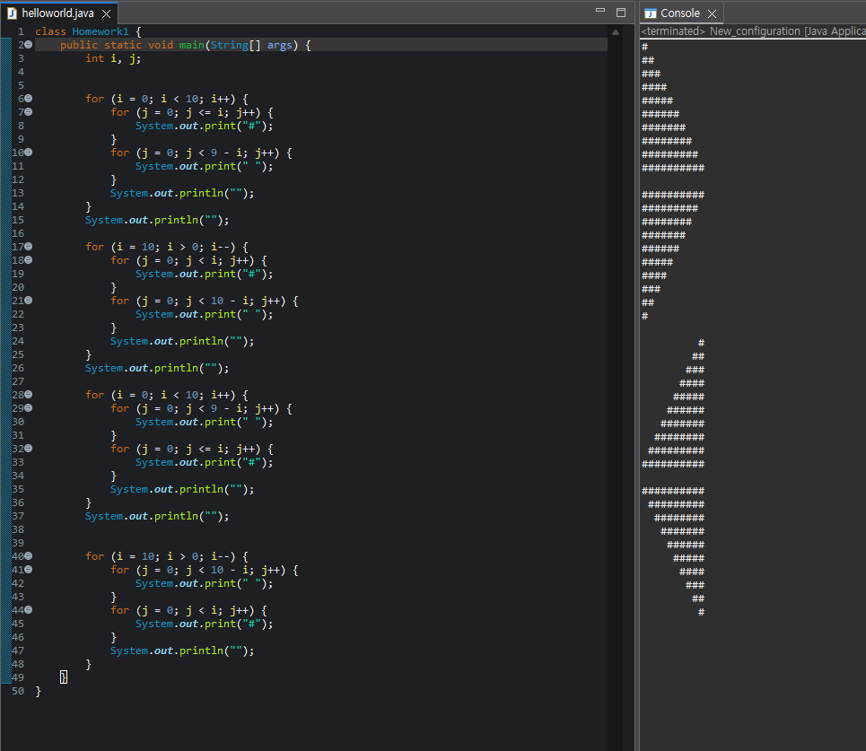

### Homework2
```java
public class Homework2 {
	public static void main(String[] args) {
		int a = 1;
		int b = 1;
		int c;
		
		System.out.print(a + " " + b + " ");
		
		for (int i = 3; i<=20; i++) {
			c = a + b;
			System.out.print(c + " ");
			
			a = b;
			b = c;
		}
		
	}
}
```
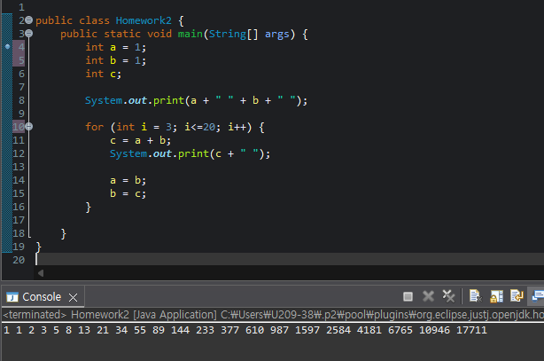

### Homework3
```java
public class homework3 {
    public static void main(String[] args) {
        int a = 1;
        int b = 1;
        int c = a + b;

        System.out.println(c + "/" + b + "=" + ((double)c / b));

        a = b;
        b = c;

        for (int i = 2; i <= 20; i++) {
            c = a + b;
            
            System.out.println(c + "/" + b + "=" + ((double)c / b));

            a = b;
            b = c;
        }
    }
}
```
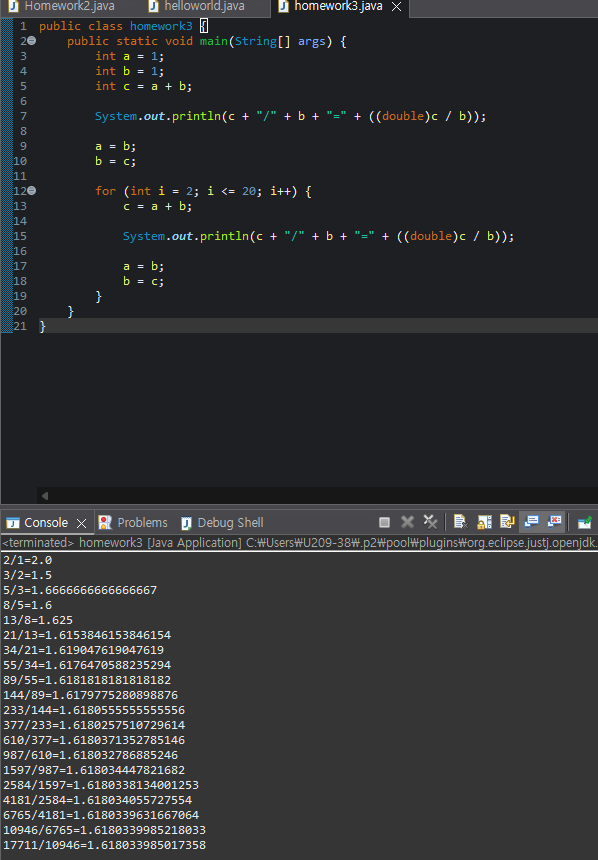

### Homework4
```java
public class Homework4 {
    public static void main(String[] args) {
        for (int i = 1; i <= 9; i++) {
            for (int j = 1; j <= 9; j++) {
                System.out.print(j + "*" + i + "=" + (j * i) + "\t");
            }
            System.out.println();
        }
    }
}
```
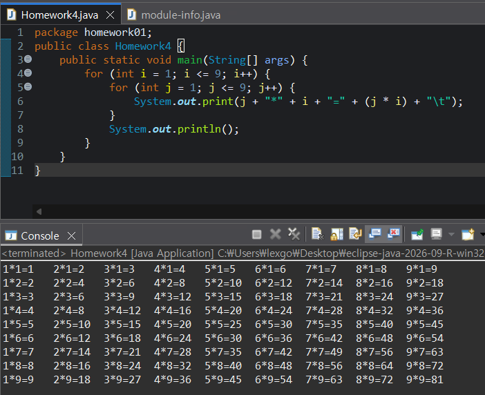

### Homework5
```java
public class Homework5 {
    public static void main(String[] args) {
        
        double pi1 = 0;
        double sign = 1.0;
        
        for (int i = 0; i < 20; i++) {
            pi1 += sign * (4.0 / (2 * i + 1));
            sign = -sign;
        }
        
        System.out.println("Gregory-Leibniz 결과: " + pi1);
        
        System.out.println();
        
        double sum = 0;
        
        for (int k = 0; k < 20; k++) {
            double power = Math.pow(-1.0 / 3.0, k);
            double term = power / (2 * k + 1);
            sum += term;
        }
        
        double pi2 = Math.sqrt(12) * sum;
        
        System.out.println("Madhava 결과: " + pi2);
    }
}

```
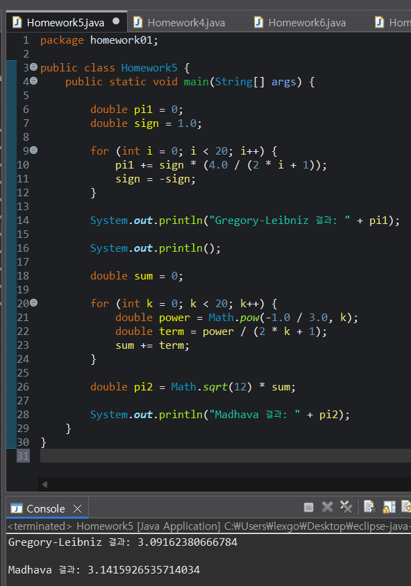

### Homework6
```java
public class Homework6 {
    public static void main(String[] args) {
        int[][] binomial = new int[7][7];
        
        for (int i = 0; i < binomial.length; i++) {
            for (int j = 0; j <= i; j++) {
                if (j == 0 || j == i) {
                    binomial[i][j] = 1;
                } else {
                    binomial[i][j] = binomial[i - 1][j - 1] + binomial[i - 1][j];
                }
                System.out.print(binomial[i][j] + " ");
            }
            System.out.println();
        }
    }
}
```
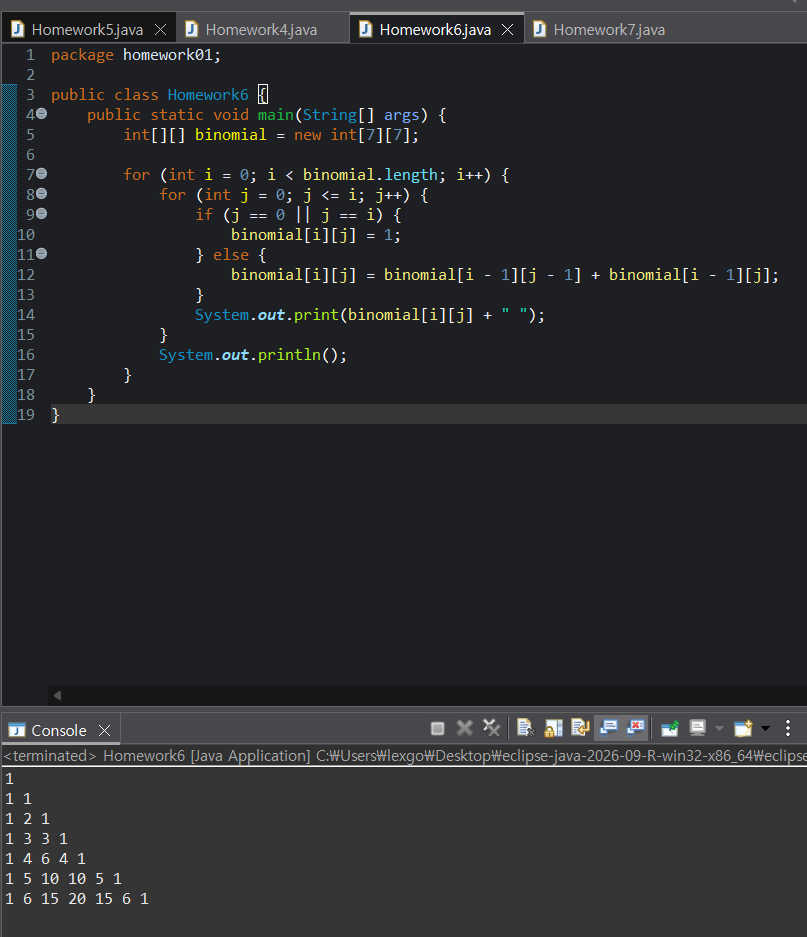

### Homework7
```java
public class Homework7 {
    public static void main(String[] args) {
        int[] data = new int[20];
        
        for (int i = 0; i < 20; i++) {
            data[i] = (int)(Math.random() * 100);
        }
        
        for (int i = 0; i < data.length - 1; i++) {
            int minIndex = i;
            for (int j = i + 1; j < data.length; j++) {
                if (data[j] < data[minIndex]) {
                    minIndex = j;
                }
            }
            int temp = data[minIndex];
            data[minIndex] = data[i];
            data[i] = temp;
        }
        
        for (int i = 0; i < 20; i++) {
            System.out.println(data[i]);
        }
    }
}

```
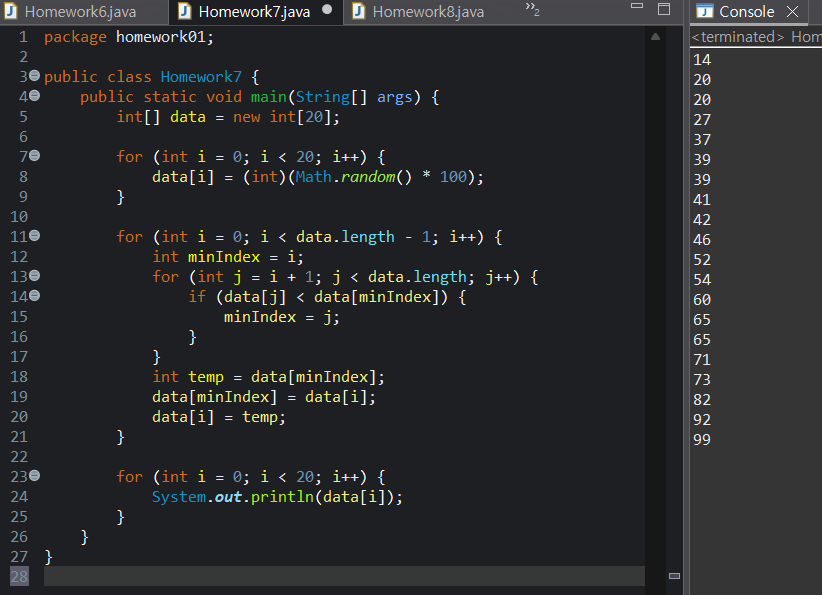

### Homework8
```java
public class Homework8 {
    public static void main(String[] args) {
        int studentCount = 30;
        int[][] score = new int[studentCount][4];
        
        for (int i = 0; i < studentCount; i++) {
            int sum = 0;
            System.out.print((i + 1) + " ");
            for (int j = 0; j < 4; j++) {
                score[i][j] = (int)(Math.random() * 101);
                sum += score[i][j];
                System.out.print(score[i][j] + " ");
            }
            System.out.println(sum);
        }
    }
}
```
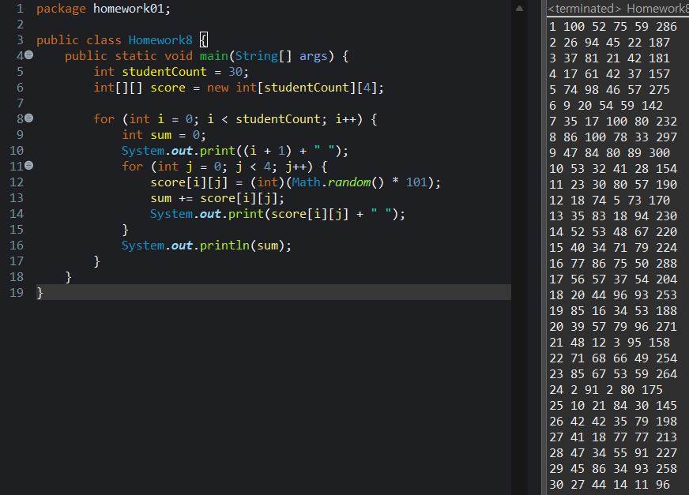

### Homework9
```java
public class Homework9 {
    public static void main(String[] args) {
        int array_count, max_value, bin_size, display_scale, hist_size;
        if (args.length != 4)
            return;
        array_count = Integer.parseInt(args[0]);
        max_value = Integer.parseInt(args[1]);
        bin_size = Integer.parseInt(args[2]);
        display_scale = Integer.parseInt(args[3]);
        hist_size = max_value / bin_size;
        
        int[] arr = new int[array_count];
        int[] hist = new int[hist_size];
        for (int i = 0; i < array_count; i++) {
            arr[i] = (int) (Math.random() * max_value);
        }
        for (int i = 0; i < array_count; i++) {
            System.out.print(arr[i] + " ");  
        }
        System.out.println();  
        
        for (int i = 0; i < array_count; i++) {
            hist[arr[i] / bin_size]++;
        }
        for (int i = 0; i < hist_size; i++) {
            System.out.print(hist[i] + " ");  
        }
        System.out.println();  
    }
}
```
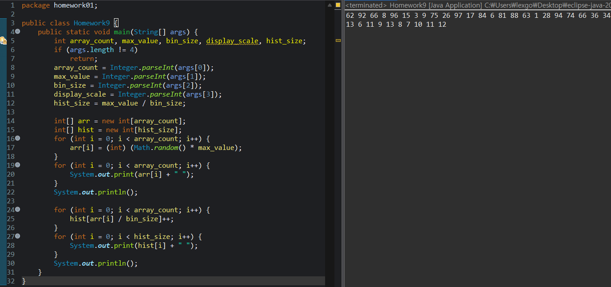

### Homework10
```java
public class Homework10 {
    public static void main(String[] args) {
        int array_count, max_value, bin_size, display_scale, hist_size;
        if (args.length != 4)
            return;
        array_count = Integer.parseInt(args[0]);
        max_value = Integer.parseInt(args[1]);
        bin_size = Integer.parseInt(args[2]);
        display_scale = Integer.parseInt(args[3]);
        hist_size = max_value / bin_size;
        
        int[] arr = new int[array_count];
        int[] hist = new int[hist_size];
        for (int i = 0; i < array_count; i++) {
            arr[i] = (int) (Math.random() * max_value);
        }
        for (int i = 0; i < array_count; i++) {
            System.out.print(arr[i] + " ");  
        }
        System.out.println();  
        
        for (int i = 0; i < array_count; i++) {
            hist[arr[i] / bin_size]++;
        }
        for (int i = 0; i < hist_size; i++) {
            System.out.print(hist[i] + " ");  
        }
        System.out.println();  
    }
}
```
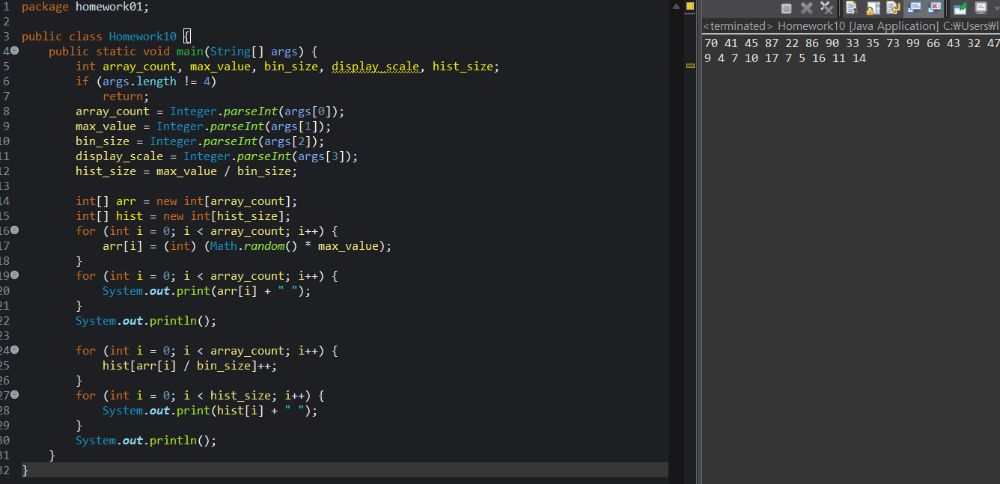

### Homework11
```java
public class Homework11 {
    public static void main(String[] args) {
        int array_count;
        if (args.length != 1)
            return;
        array_count = Integer.parseInt(args[0]);
        int[] arr = new int[array_count];
        for (int i = 0; i < array_count; i++) {
        	arr[i] = (int) (Math.random() * 99) + 1;
        }
        for (int i = 0; i < array_count; i++) {
            System.out.print(arr[i] + " ");  
        }
        System.out.println();
        
        double sum = 0;
        for (int i = 0; i < array_count; i++) {
            sum += arr[i];
        }
        System.out.printf("arithmetic mean : = %f\n", sum / array_count);
        
        double prod = 1;
        for (int i = 0; i < array_count; i++) {
            prod *= arr[i];
        }
        System.out.printf("geometric mean : = %f\n", Math.pow(prod, (double) 1. / array_count));
        
        double reciprocalSum = 0;
        for (int i = 0; i < array_count; i++) {
            reciprocalSum += 1.0 / arr[i];
        }
        System.out.printf("harmonic mean : = %f\n", array_count / reciprocalSum);
        
        for (int i = 0; i < arr.length - 1; i++) {
            for (int j = i + 1; j < arr.length; j++) {
                if (arr[i] > arr[j]) {
                    int temp = arr[i];
                    arr[i] = arr[j];
                    arr[j] = temp;
                }
            }
        }
        
        double median;
        if (array_count % 2 == 0) {
            median = (arr[array_count / 2 - 1] + arr[array_count / 2]) / 2.0;
        } else {
            median = arr[array_count / 2];
        }
        System.out.printf("median : = %f\n", median);
    }
}
```
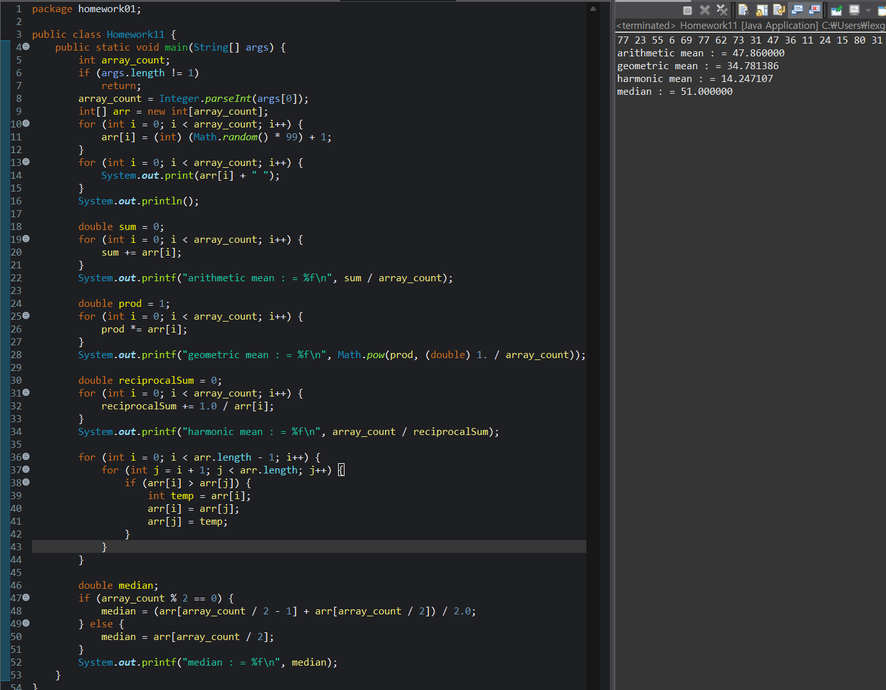

### Homework13
```java
import java.util.Scanner;

public class Homework13 {
    public static void main(String[] args) {
        Scanner scanner = new Scanner(System.in);
        
        while (true) {
            String inputString = scanner.nextLine();
            if (inputString.equalsIgnoreCase("exit") || inputString.equalsIgnoreCase("q")) {
                break;
            }
            
            String[] arrOfStr = inputString.split(" ");
            
            if (arrOfStr.length < 3 || arrOfStr.length % 2 == 0) {
                continue;
            }
            
            double result = Double.parseDouble(arrOfStr[0]);
            
            for (int i = 1; i < arrOfStr.length; i += 2) {
                String op = arrOfStr[i];
                double nextNum = Double.parseDouble(arrOfStr[i + 1]);
                
                if (op.equals("+")) {
                    result += nextNum;
                } else if (op.equals("-")) {
                    result -= nextNum;
                } else if (op.equals("#") || op.equals("*")) {
                    result *= nextNum;
                } else if (op.equals("/")) {
                    result /= nextNum;
                }
            }
            
            if (result == (long) result) {
                System.out.println((long) result);
            } else {
                System.out.println(result);
            }
        }
        
        scanner.close();
    }
}
```
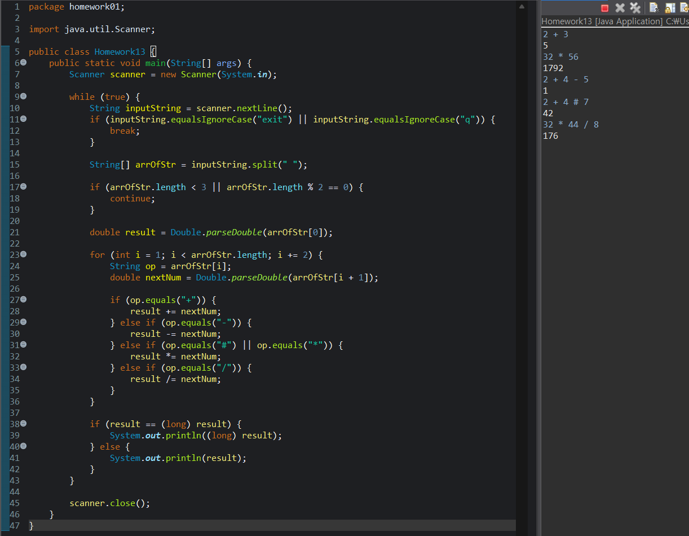

### Homework14
```java
import java.util.Arrays;

public class Numbers {
    int num[];

    Numbers(int num[]) {
        this.num = num;
    }

    double getTotal() {
        double sum = 0;
        for (int i = 0; i < num.length; i++)
            sum += num[i];
        return sum;
    }

    double getArithmeticMean() {
        return getTotal() / num.length;
    }

    double getHarmonicMean() {
        double reciprocalSum = 0;
        for (int i = 0; i < num.length; i++) {
            reciprocalSum += 1.0 / num[i];
        }
        return num.length / reciprocalSum;
    }

    double getGeometricMean() {
        double prod = 1;
        for (int i = 0; i < num.length; i++) {
            prod *= num[i];
        }
        return Math.pow(prod, 1.0 / num.length);
    }

    double getMedian() {
        int[] sorted = num.clone();
        sorting(sorted);
        if (sorted.length % 2 == 0) {
            return (sorted[sorted.length / 2 - 1] + sorted[sorted.length / 2]) / 2.0;
        } else {
            return sorted[sorted.length / 2];
        }
    }

    void sorting(int[] arr) {
        Arrays.sort(arr);
    }

    void drawHistogram(int start, int end, int binSize, int scale) {
        int range = end - start;
        int histSize = range / binSize;
        int[] hist = new int[histSize];

        for (int i = 0; i < num.length; i++) {
            if (num[i] >= start && num[i] < end) {
                int idx = (num[i] - start) / binSize;
                hist[idx]++;
            }
        }

        System.out.println("\n--- Histogram ---");
        for (int i = 0; i < histSize; i++) {
            int low = start + i * binSize;
            int high = low + binSize - 1;
            System.out.printf("%2d~%2d\t", low, high);
            int count = hist[i] / scale;
            for (int j = 0; j < count; j++) {
                System.out.print("#");
            }
            System.out.println();
        }
    }

    void display() {
        System.out.printf("%3d : ", num.length);
        for (int i = 0; i < num.length; i++) {
            System.out.printf("%3d ", num[i]);
        }
        System.out.println();
    }
}

public class NumbersTest {
    public static void main(String[] args) {
        int size = 100;
        int data[] = new int[size];
        for (int i = 0; i < size; i++) {
            data[i] = (int) (Math.random() * 99) + 1;
        }

        Numbers obj = new Numbers(data);
        obj.display();

        System.out.printf("Arithmetic Mean : %5.2f\n", obj.getArithmeticMean());
        System.out.printf("Geometric Mean  : %5.2f\n", obj.getGeometricMean());
        System.out.printf("Harmonic Mean   : %5.2f\n", obj.getHarmonicMean());
        System.out.printf("Median          : %5.2f\n", obj.getMedian());

        obj.drawHistogram(0, 100, 10, 1);
    }
}
```
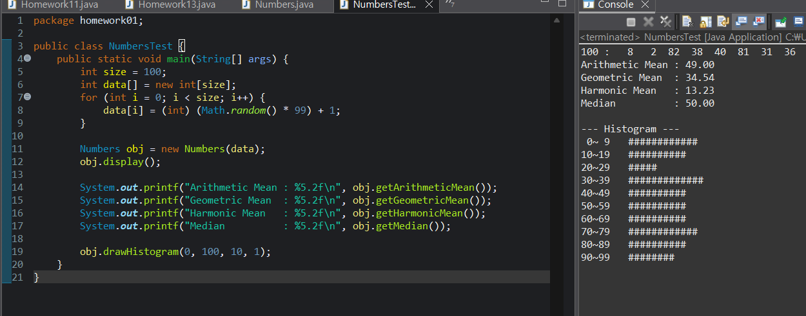
